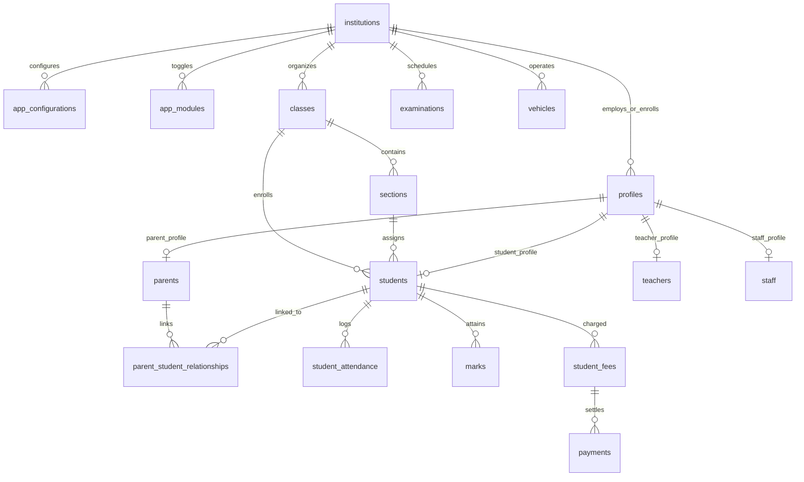

# NORTHERN STAR SMART CAMPUS - DATABASE ARCHITECTURE SPECIFICATION

**Database Engine:** PostgreSQL 15+ (Supabase Free-Tier Optimized)  
**Schema Architecture:** Normalized 3NF, Single-Institution First with SaaS-Ready Tenant Isolation (`institution_id`)

---

## 1. Entity-Relationship Overview

---

## 2. Table Catalog

### A. Institution & Remote Application Control
- `institutions`: Core institutional entity (Northern Star School & College).
- `institution_settings`: Dynamic JSONB institutional parameters.
- `app_configurations`: Remote configuration controlling mobile branding, colors, contact details, welcome banner, and maintenance mode.
- `app_modules`: Centrally manages feature toggles (`attendance`, `homework`, `results`, `fees`, `library`, `transport`, `digital_id`, `routine`, `communication`, `events`).
- `app_navigation`: Role-specific navigation menus and action layouts.
- `app_banners`: Mobile carousel promotional announcements.

### B. User Management & Profiles
- `profiles`: Unified user directory linked to `auth.users` via UUID foreign key.
- `students`: Academic records, roll numbers, student ID codes (`NSC2025001`), QR tokens.
- `parents`: Guardian details and emergency contact records.
- `parent_student_relationships`: Granular parent-to-student links for portal security.
- `teachers`: Faculty records, qualifications, departmental affiliations, and salaries.
- `staff`: Administrative and operational employee profiles.

### C. Academic Structure & Scheduling
- `academic_years`: Annual school/college academic cycles (e.g., 2025-2026).
- `classes`: Classes 1 through 12, categorized by primary, school, and college.
- `sections`: Sections A, B, Morning, Day.
- `subjects`: Theory and practical subject catalogue.
- `class_routines`: Period timetables, start/end times, and room numbers.

### D. Attendance, Examinations & Finance
- `student_attendance`: Daily class attendance logs (present, absent, late, excused).
- `examinations`: Scheduled exams (e.g., Term Final Exam 2025).
- `marks`: Numerical grades and verification flags.
- `results`: Computed GPAs, letter grades (A+), class rankings (1st Position), and transcripts.
- `fee_categories` & `fee_structures`: Class-wise monthly tuition, exam, and admission fees.
- `student_fees` & `payments`: Fee ledgers, payment recording, and receipts (`REC-2025-...`).

### E. Campus Operations & Fleet
- `books` & `book_transactions`: Digital library inventory and borrowing records.
- `vehicles`: Campus fleet (12 registered buses, e.g., Bus #03).
- `visitors` & `visitor_logs`: Gate visitor registration and QR pass check-ins.
- `audit_logs`: Immutable tracking of security, academic, and financial actions.
